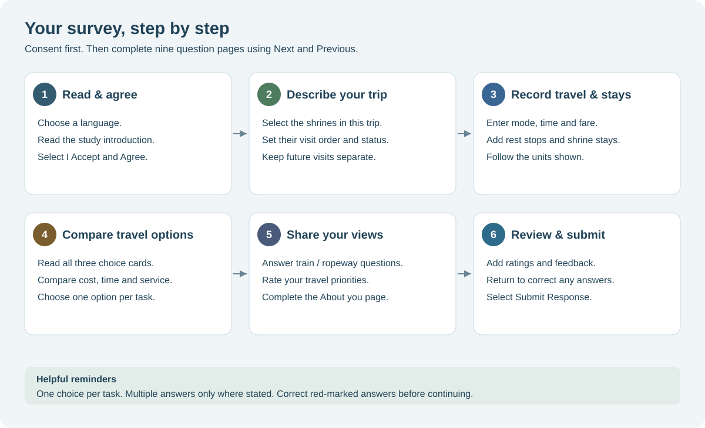
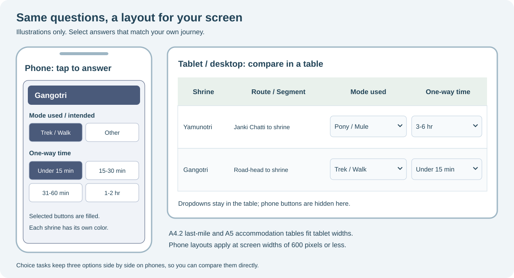

# Pilgrimage Travel Survey

A mobile-friendly research survey about travel to Kedarnath, Badrinath, Gangotri, Yamunotri and Hemkund Sahib in Uttarakhand.

**[Open the survey](https://anujn08.github.io/hemkund_sahib_survey/)** | **[GitHub repository](https://github.com/anujn08/hemkund_sahib_survey)**

## How to fill the survey

Open the [live survey](https://anujn08.github.io/hemkund_sahib_survey/) in your browser. Choose your language, read the introduction, and select **I Accept and Agree** to begin. Consent is separate from the **nine question pages**: the trip page starts at **Page 1 of 9**.



### Page-by-page guide

| Page | Section | What to do |
| --- | --- | --- |
| 1 | Your trip and shrines | Select trip status, travel group, and shrines included in this trip. Mark previous visits and choose the order of shrine visits. |
| 2 | Main-haul travel | Describe travel from your starting point to the first base town, journeys between shrine bases, and the return journey. Add vehicles, transfers, time, fares, and food/rest/overnight stops where applicable. |
| 3 | Last-mile travel and accommodation | Enter travel from the base camp or road-head to the shrine, return last-mile details where applicable, stay duration, accommodation type, and accommodation cost. |
| 4 | Main-haul travel choices | Compare the three alternatives in each displayed task and select **one** option. Read the cost, time, comfort, reliability, and vehicle-change details shown. |
| 5 | Last-mile travel choices | Compare the displayed options for reaching the shrine and select **one** per task. Use Next if no tasks apply to your selected shrines. |
| 6 | Trains and ropeways | Answer the willingness-to-use questions. Follow-up questions depend on your answers. |
| 7 | Travel priorities | Rate how much each listed factor matters, using the scale provided. |
| 8 | About you | Fill in demographic details, occupation, highest education level, and optional household income. |
| 9 | Feedback | Rate your trip, select challenges faced, and add suggestions. Optional lucky-draw contact details can be left blank. Select **Submit Response** when finished. |

### Selecting answers and correcting mistakes

- **Single-choice buttons:** tap one option. A filled background identifies the selected answer.
- **Multiple-choice questions:** choose more than one only where the question says to select all that apply.
- **Previous visits (A2):** select a count only for a shrine visited before. Tap the selected number again to clear an accidental answer. The **Visiting on this Trip?** checkbox is a separate answer.
- **Shrine order:** choose the first shrine, then the next shrines in order. Tap a selected shrine again to clear that position; duplicate shrine choices are prevented.
- **Ongoing trips:** set each shrine's status accurately: Completed, Currently travelling / at the shrine, Planned next, or Planned later. These answers determine which later questions apply. Future last-mile journeys are skipped, and upcoming-stay questions ask about known bookings rather than actual stay duration.
- **Time and cost:** use the units and basis beside each field. Last-mile fares are one-way, per person; accommodation asks for total accommodation cost. Choose **Other / exact** where offered to enter a specific value. Use a zero-cost choice only if there was no charge.
- **Choice cards:** compare all three alternatives before choosing one. The example cards explain the task and cannot be selected.

### Moving between pages and submitting

Use **Next** to continue and **Previous** to review earlier answers. Missing or invalid required answers are marked; correct them before moving forward. Changing an earlier answer can reveal different conditional questions, so review the affected later pages again.

An unfinished draft is saved in the same browser. On reopening the survey, use **Resume Survey** to continue or **Start Fresh** to discard that draft. Drafts do not transfer between browsers or devices.

On the last page, select **Submit Response** and wait for the thank-you page. The survey keeps a local browser backup and sends the response to the configured Google Sheets endpoint. The thank-you page is not an independent confirmation that the remote spreadsheet received the response; administrators should verify receipt in Sheets when checking a deployment.

### Phone, tablet, and desktop views



*These drawings illustrate the interface; their values are examples, not suggested answers or screenshots of submitted responses.*

| Device width | How the entry sections work |
| --- | --- |
| Phone: 600 px or less | A4.1c stopovers, A4.2 last-mile travel, and A5 accommodation appear as stacked cards with colored shrine headers. Dropdown options in those tables become tap-to-select buttons. Stay duration also uses buttons. |
| Tablet: above 600 px | Entry sections use tables and dropdowns. A4.2 and A5 fit all columns to tablet widths without sideways scrolling. Other wide matrices may still scroll horizontally. |
| Desktop / laptop | Tables retain their columns and dropdown controls. Shrines retain consistent colors across the relevant entry sections. |

Choice tasks keep the three alternatives **side by side on phones** for comparison. Route illustrations scroll normally with the page. The layout responds to browser width, including split-screen and resized windows.

## Run locally

From this directory, run:

```sh
python -m http.server 8000
```

Open http://localhost:8000. Serve the files over HTTP rather than opening `index.html` directly, because the choice-card data is loaded from CSV files.

## Publish updates

Push changes to the `main` branch. The **Publish survey to GitHub Pages** workflow checks the JavaScript and Google Sheets column mappings, then publishes the HTML, CSS, JavaScript, choice-design CSV files and images.

GitHub repository settings must have **Pages > Source > GitHub Actions** enabled. Deployment progress is available under the Actions tab.

Only public site assets are uploaded to Pages. Respondent workbooks, test response JSON and local audit files are excluded from version control and the deployment artifact.

## Google Sheets backend

`google_apps_script.gs` is the source for the separately deployed Apps Script web app. Website updates do not update Apps Script automatically. After changing that file, replace the deployed Apps Script source and update its existing deployment to a new version.

The survey submits to the Apps Script `/exec` endpoint configured in `handleFormSubmit()` in `script.js`. Keep that URL aligned with the intended deployment.

See [DATA_ANALYSIS_NOTES.md](DATA_ANALYSIS_NOTES.md) for sheet names, question fields, conditional answers, coding and version tracking. The Sheets endpoint was tested before initial publication; future deployment/configuration changes should be checked with a clearly labelled test response.

## Validation

```sh
node --check script.js
node tests/sheets_schema.test.cjs
```

The schema tests mock Google Sheets and do not submit real responses.

## Main files

- `index.html`, `style.css`, `script.js`: questionnaire and responsive interface.
- `main_haul.csv`, `last_mile.csv`: stated-choice card designs.
- `images/`: survey images and backgrounds.
- `docs/images/`: pictorial README guides (illustrative SVG diagrams).
- `google_apps_script.gs`: Google Sheets ingestion and structured analysis tables.
- `tests/sheets_schema.test.cjs`: column-mapping and data-preservation checks.

Archive each questionnaire and choice-design version with the collected data. Keep respondent data out of this public repository.
